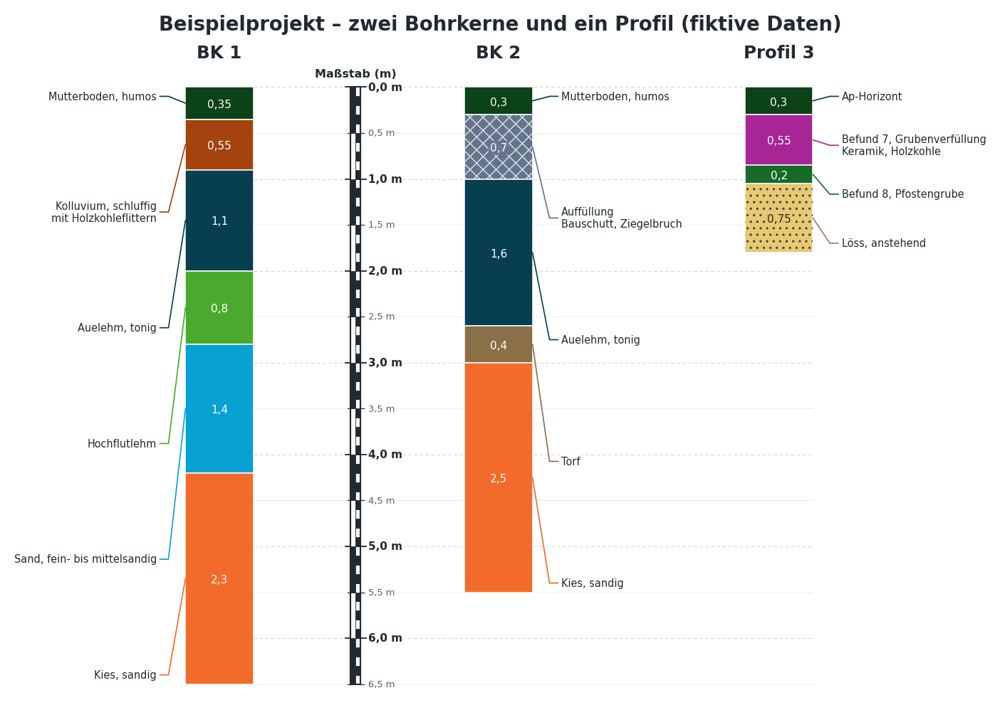
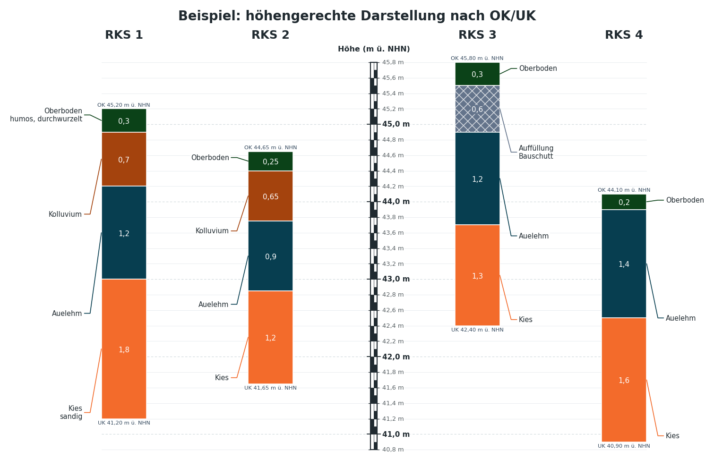
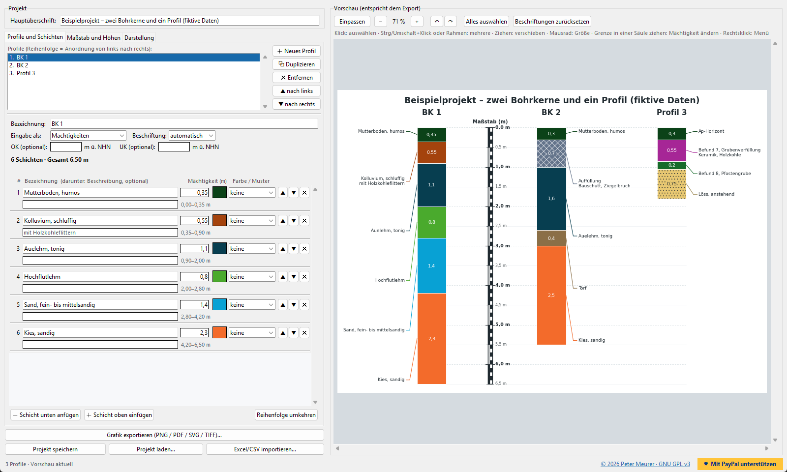

# Fremdprofilierung

[](https://paypal.me/PeMeurer)
[](LICENSE)

Zeichnet beliebig viele **Bohrkerne oder archäologische Profile** nebeneinander:
farbige Schichten mit Mächtigkeiten, Nivellierlatte als Maßstab, Beschriftungen
mit Führungslinien. Optional werden die Profile nach OK/UK (z. B. m ü. NHN)
höhengerecht versetzt. Oberfläche mit Live-Vorschau (Tkinter + matplotlib),
Export als PNG, PDF, SVG, TIFF oder JPG.







© 2026 Peter Meurer · freie Software unter der [GNU GPL v3](LICENSE)

Gefällt Ihnen das Programm? Über eine Unterstützung per
**[PayPal](https://paypal.me/PeMeurer)** freue ich mich.

## Installation und Start

1. [Python](https://www.python.org/downloads/) 3.8 oder neuer installieren.
2. Benötigte Pakete installieren (matplotlib bietet das Programm beim ersten Start auch selbst an):
   ```
   pip install matplotlib openpyxl
   ```
3. Starten:
   ```
   python Fremdprofilierung.py
   ```
   (oder Doppelklick auf die Datei). Ein Projekt direkt öffnen:
   `python Fremdprofilierung.py projekt.json`

## Funktionen

| | |
|---|---|
| **Beliebig viele Profile** | Profilliste mit Neu / Duplizieren / Entfernen / Verschieben. Die Reihenfolge ist die Anordnung von links nach rechts; Spaltenbreiten richten sich nach den Beschriftungen, nichts überlappt. |
| **Mächtigkeiten, Tiefen oder Höhen** | Pro Profil wählbar unter *Eingabe als*. Beim Wechsel werden die Werte verlustfrei umgerechnet; der Editor zeigt unter jeder Schicht die übrigen Größen an. |
| **Maßstab passt sich an** | Bereich und Teilung (0,1 / 0,2 / 0,5 / 1 / 2 / 5 … m) werden bei jeder Änderung neu bestimmt, z. B. bei neuer Gesamttiefe; Maßstabszahlen überlappen nie. Optional fest einstellbar, auch als Druckmaßstab (z. B. 1:20). |
| **Maßstab verschieben** | Position wählbar (links außen, zwischen zwei Profilen, rechts außen) oder in der Vorschau mit der Maus ziehen. Die Beschriftungen wechseln automatisch auf die Außenseite. |
| **OK/UK, höhengerecht versetzt** | OK und/oder UK des Profils eintragen (optional). Die Profile werden dann nach Höhe versetzt gezeichnet, der Maßstab zeigt Höhen. Passen OK, UK und Schichten nicht zusammen, erscheint ein Hinweis. |
| **Auswählen wie im Explorer** | Klick wählt aus, **Strg+Klick** fügt hinzu/entfernt, **Umschalt+Klick** wählt einen Bereich (z. B. alle Beschriftungen von Schicht 2 bis 5), ein **Rahmen** auf freier Fläche wählt alles darin, **Strg+A** alles, **Esc** hebt auf. |
| **Beschriftungen ändern** | Auswahl **ziehen** = verschieben, **Mausrad** = Größe, Pfeiltasten = fein verschieben, +/− = Größe, **Entf** = zurücksetzen, **Rechtsklick** = Menü, **Doppelklick** = Schicht im Editor öffnen. Gilt für Schichtbeschriftungen, Werte im Balken, Überschriften, Maßstabstitel, Maßstabszahlen und Koten; die Änderungen werden im Projekt gespeichert. |
| **Schichten in der Säule ziehen** | Eine Schichtgrenze mit der Maus nach oben oder unten ziehen: die Schicht darüber wird dicker, die darunter dünner, die Werte im Editor ändern sich mit (in jeder Eingabeart). Mit **Umschalt** wandern alle tieferen Grenzen mit. |
| **Vorschau = Export** | Das Blatt wird in cm aufgebaut; Vorschau und Export sind identisch. In PDF-Dateien bleiben Texte bearbeitbar. |
| **Weiteres** | Zoom (Strg+Mausrad), Rückgängig/Wiederholen (Strg+Z / Strg+Y), Höhenkoten je Profil oder an allen Schichtgrenzen, Zusatzangaben in der Beschriftung (Mächtigkeit, Tiefe von–bis, Höhe von–bis), Schraffuren, automatische Textfarbe, „Farben nach Bezeichnung angleichen“. |

## Eingabearten

* **Mächtigkeiten** – Dicke jeder Schicht in m.
* **Tiefen der Unterkanten** – z. B. 0,40 / 0,50 / 1,20 m unter der Oberkante des Profils.
* **Höhen der Unterkanten** – absolute Höhen, z. B. 45,50 / 44,90 m ü. NHN; dafür muss die OK des Profils eingetragen sein.

Zahlen dürfen mit Komma oder Punkt eingegeben werden. Fehlende Werte werden
gelb, Fehler (z. B. eine Tiefe kleiner als die vorherige) rot markiert und in
der Statuszeile erklärt.

## Projekte, Import und Export

* Projekte werden als `.json` gespeichert; Projekte der Vorversion
  (Bohrprofil-Generator) lassen sich weiterhin öffnen.
* **Excel-/CSV-Import** (siehe `Beispiele/Import_Vorlage.xlsx` und `.csv`):
  1. mit Kopfzeile, z. B. `Profil | Schicht | Mächtigkeit | Beschreibung | Farbe | OK`
     (statt *Mächtigkeit* auch *Tiefe* oder *Höhe*; Angaben in cm/mm in der Kopfzeile
     werden umgerechnet; die Spalte *Profil* gruppiert die Zeilen; Titelzeilen darüber sind erlaubt), oder
  2. im Blockformat der Vorversion: Spalte A Bezeichnung, B Mächtigkeit, optional C Beschreibung;
     Leerzeilen trennen Profile, eine Zeile nur mit Text in Spalte A wird zur Profilüberschrift.
* **Export ohne Oberfläche**:
  ```
  python Fremdprofilierung.py --export bild.png projekt.json --dpi 300
  ```

## Beispiele (fiktive Daten)

* `Beispiele/Beispiel_Profile.json` – zwei Bohrkerne und ein archäologisches Profil
* `Beispiele/Beispiel_Hoehen_versetzt.json` – vier Sondierungen mit OK/UK, gemischte Eingabearten

## Tests

```
python tests/test_core.py        # Kernlogik (Geometrie, Maßstab, Import, Export, Kommandozeile)
python tests/render_scenarios.py # rendert Testszenarien nach tests/output
python tests/gui_smoke.py        # bedient die Oberfläche automatisch (öffnet kurz ein Fenster)
```

## Lizenz

Copyright © 2026 Peter Meurer

Dieses Programm ist freie Software: Sie können es unter den Bedingungen der
GNU General Public License, Version 3, weitergeben und/oder verändern.
Es wird in der Hoffnung verteilt, dass es nützlich ist, aber **ohne jede
Gewährleistung** – sogar ohne die implizite Gewährleistung der Marktfähigkeit
oder Eignung für einen bestimmten Zweck. Den vollständigen Lizenztext enthält
die Datei [LICENSE](LICENSE).
